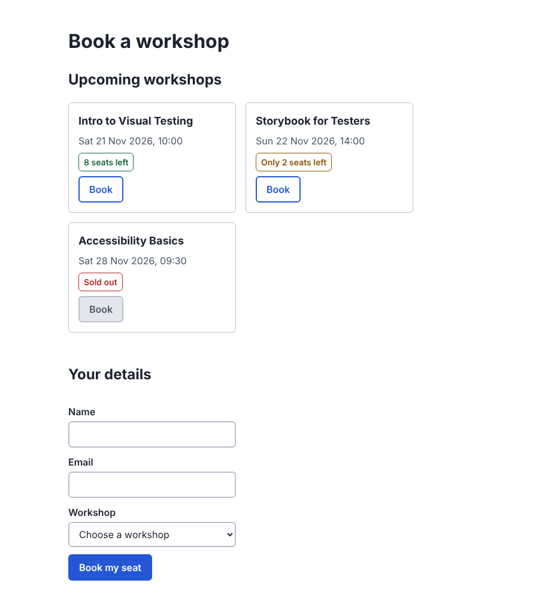
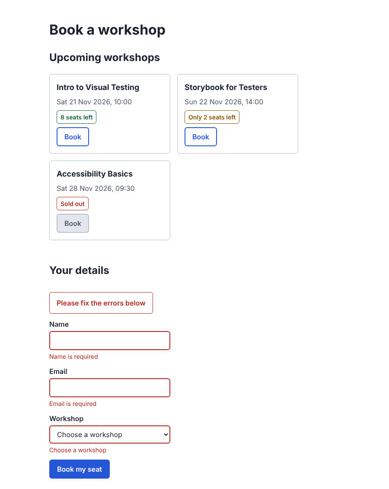
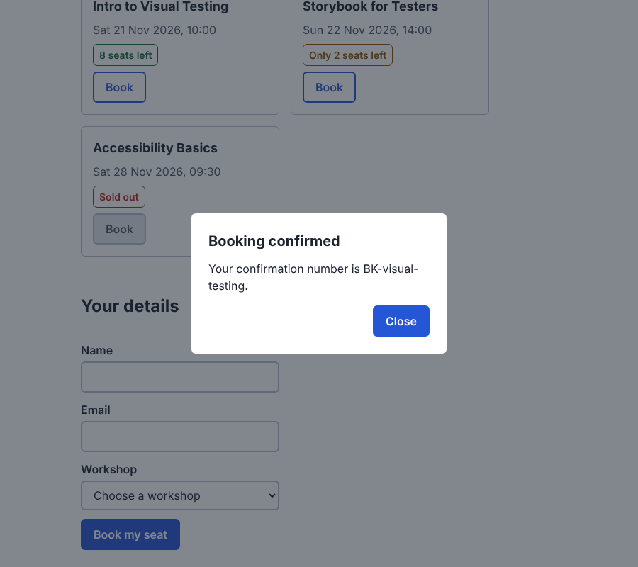
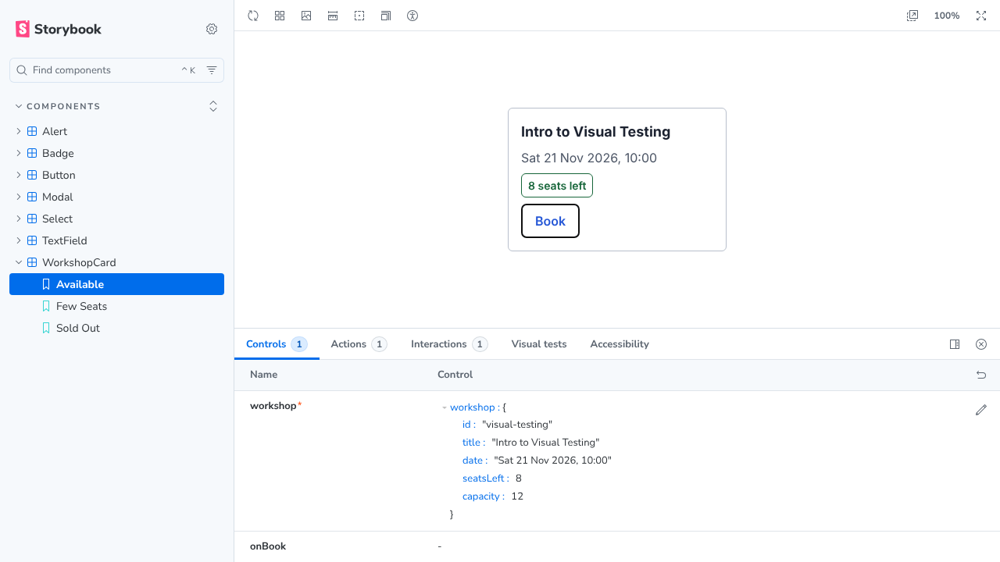
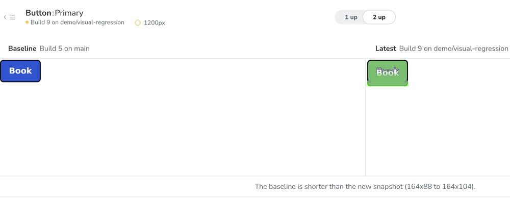
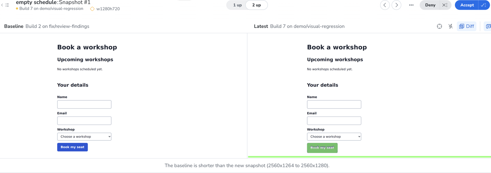

# Storybook + Chromatic + Playwright UI testing showcase

[](https://github.com/ksycz/storybook-chromatic-ui-testing/actions/workflows/ci.yml)
[](https://github.com/ksycz/storybook-chromatic-ui-testing/actions/workflows/chromatic.yml)
[](https://github.com/ksycz/storybook-chromatic-ui-testing/actions/workflows/e2e.yml)

**[Live Storybook](https://main--6af8b288ec94864c522d8fae.chromatic.com)** (published by Chromatic from `main`)

A small workshop-booking app (React, TypeScript, Vite) built to show a complete UI testing workflow: components tested in isolation in Storybook, user flows tested end to end with Playwright, and every visual change reviewed and approved in Chromatic on the pull request. Everything runs in GitHub Actions.

## What it looks like

| Booking page | Validation errors |
|---|---|
|  |  |

| Confirmation dialog | Storybook component explorer |
|---|---|
|  |  |

## What is tested where

| What | Tool | What it proves |
|---|---|---|
| How a component looks | Chromatic on Storybook stories | Every state (variants, disabled, loading, error, sold out) renders as approved |
| How a component behaves | Storybook `play` functions, run with Vitest | Clicks, typing, validation wiring, disabled states, modal focus and Escape |
| Accessibility | Storybook a11y addon (axe), run with Vitest | No violations in any story; one fails the run |
| User flows | Playwright | Booking works, validation blocks bad input, sold-out workshops cannot be booked, double submit books once |
| How the whole page looks | Chromatic snapshots taken from the Playwright tests | The composed page and its key states look as approved |

## How the tools fit together

1. **Storybook** holds each component in isolation, in every state that matters (for example Button: primary, secondary, disabled, loading). Each story can also have a `play` function, which acts like a user would: it clicks, types and presses Escape, and then asserts. In CI these run as Vitest tests, and any accessibility violation found by axe fails the run. This covers *whether a component works and is accessible*.
2. **Chromatic** takes a screenshot of every story on every PR and compares it with the approved baseline. A change shows as a before/after diff that someone accepts or rejects. This covers *whether a component still looks the same*.
3. **Playwright** opens the real built app in a browser and tests user flows: book a workshop, see validation errors, try the sold-out workshop. This covers *whether the pieces work together*, which components in isolation can't show.
4. **Chromatic again, on the Playwright tests.** Each Playwright test also uploads the page as it looked at the end of the test, so the full page is reviewed visually in the same place. This covers *whether the whole page still looks the same*.

**Why both, in one sentence:** Storybook with Chromatic is quick to run and shows exactly which component changed. Playwright with Chromatic shows whether the real page and its flows still work and look right, and Chromatic is the one place to review all visual changes.

**Why the page has no stories:** each layer has one owner. Stories cover components, Playwright covers the page, and Chromatic reviews the look of both in one place.

**Why no Playwright `toHaveScreenshot()`:** that would be a second set of baselines for the same UI, and Playwright screenshots differ between operating systems. Chromatic renders everything in its own browser in the cloud, so the images stay the same whichever machine ran the tests.

## The pipelines

Three workflows run on every pull request and on pushes to `main`:

- `ci`: lint (oxlint), typecheck, Storybook tests (interaction and accessibility) and unit tests with Vitest, then the build.
- `chromatic-storybook`: publishes Storybook to Chromatic and snapshots the stories. TurboSnap limits it to stories affected by the change.
- `e2e`: runs the Playwright tests, keeps the HTML report as an artifact, then uploads the page archives to a second Chromatic project.

Chromatic jobs do not fail on visual changes. The Chromatic status check on the PR stays pending until someone accepts or rejects the changes, and accepted changes on `main` become the new baseline. `main` is protected by a ruleset: every change goes through a pull request, and force pushes and deletion are blocked. All three workflows skip changes that only touch Markdown files or `docs/`, so editing the README does not start a run. For that reason the checks are not marked as required in the ruleset (a required check that never starts would block a README-only pull request); they are reviewed on every pull request that changes code.

## See it catch a regression

[The demo pull request](https://github.com/ksycz/storybook-chromatic-ui-testing/pull/4) changes the primary colour and a button's padding. All functional tests still pass, but Chromatic shows the difference both at component level and on the full page.

**Component level (Storybook project).** The `Button: Primary` story, with the baseline from `main` on the left and the demo branch on the right. Chromatic highlights the changed pixels in green, and the new button is also 8 px taller because of the padding change (Chromatic snapshots at 2x, so the diff reports 16 px).



**Page level (Playwright project).** The `empty schedule` page snapshot taken by the Playwright suite. The same colour and padding change shows up on the real page, where the page grew by the same 8 px (2560x1264 to 2560x1280 in Chromatic's 2x snapshot).



## Run it locally

```bash
npm ci
npx playwright install chromium
npm run storybook   # component explorer at http://localhost:6006
npm test            # unit tests + every story as a test (interaction + a11y)
npm run e2e         # builds the app, serves it, runs the Playwright tests
npm run build && npm run build-storybook && npm run screenshots   # regenerates docs/images
```

To upload to Chromatic yourself, create a project at [chromatic.com](https://www.chromatic.com) and run `npx chromatic --project-token=<token>` (Storybook) or `npx chromatic --playwright --project-token=<token>` (after `npm run e2e`). In CI the tokens are the repository secrets `CHROMATIC_PROJECT_TOKEN` (Storybook project) and `CHROMATIC_PLAYWRIGHT_TOKEN` (Playwright project).

## Keeping visual tests stable

- No web fonts (system font stack), so rendering does not depend on a font loading.
- Animations and transitions are switched off globally.
- No dates, random values or locale formatting in rendered output; all data is fixed.
- Playwright tests end in a state that is already visible (they assert before the snapshot is taken).
- Chromatic renders in its own cloud browser, so snapshots do not vary with the machine that ran the tests.

## Snapshot cost

Chromatic's free plan includes 5,000 snapshots per month. One full build here is 21 stories plus 8 page snapshots. TurboSnap skips stories a change cannot affect, so most pull requests use far fewer.

## Limitations and next steps

- **Chromium only.** The Playwright tests and Chromatic snapshots use one browser. Next step: add Firefox and WebKit as Playwright projects and enable the same browsers in Chromatic.
- **Fake backend.** `submitBooking` resolves after 300 ms with a made-up confirmation number, so there is no network, no server-side validation and no real double-booking to detect. Next step: mock the API with MSW in Storybook and Playwright so error and slow-network states can be tested too.
- **Checks are not required by the ruleset**, because docs-only pull requests skip them (see above). Next step: an always-passing job for docs-only changes, so `ci`, `e2e` and both Chromatic checks can be required.
- **Small UX gaps worth testing next:** the error summary does not move focus to the first invalid field, and the form can still be edited while a booking is being sent.

## Design and plan

The design and the implementation plan this was built from are in [`docs/superpowers/`](docs/superpowers/).
